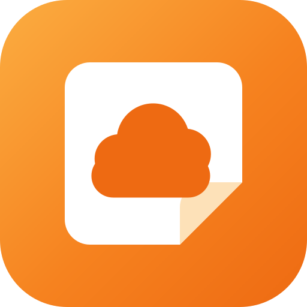
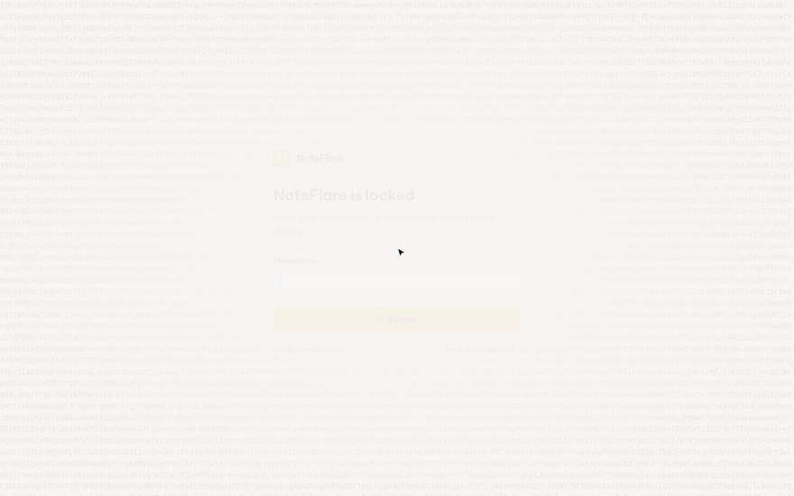
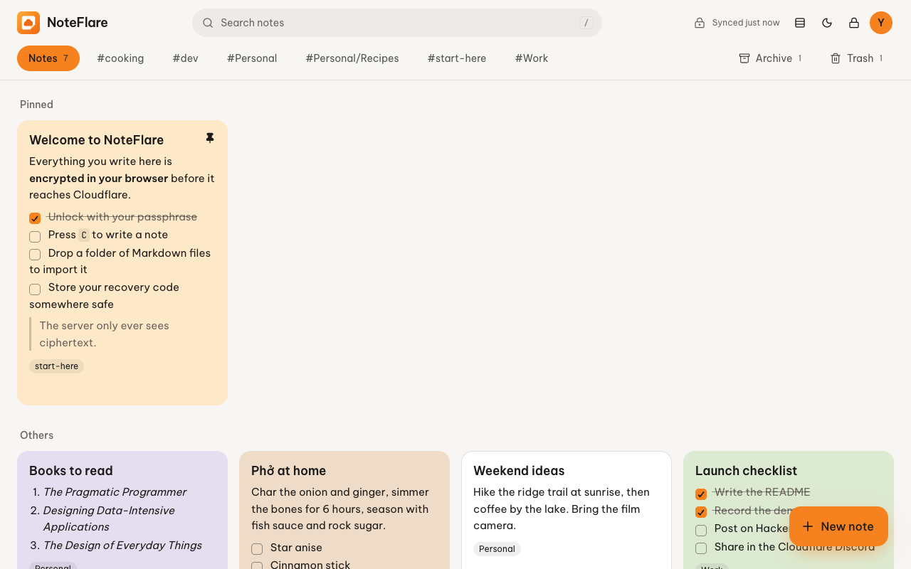
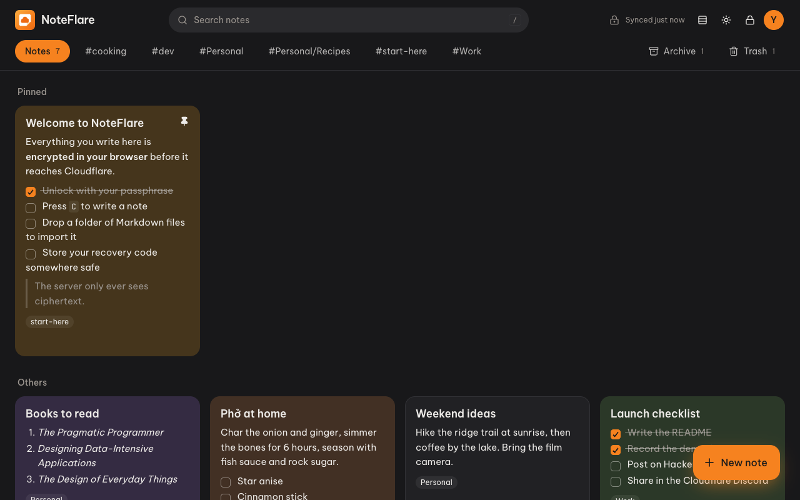
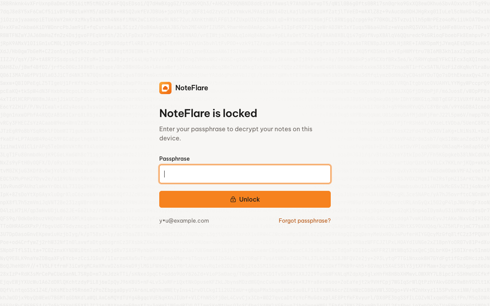
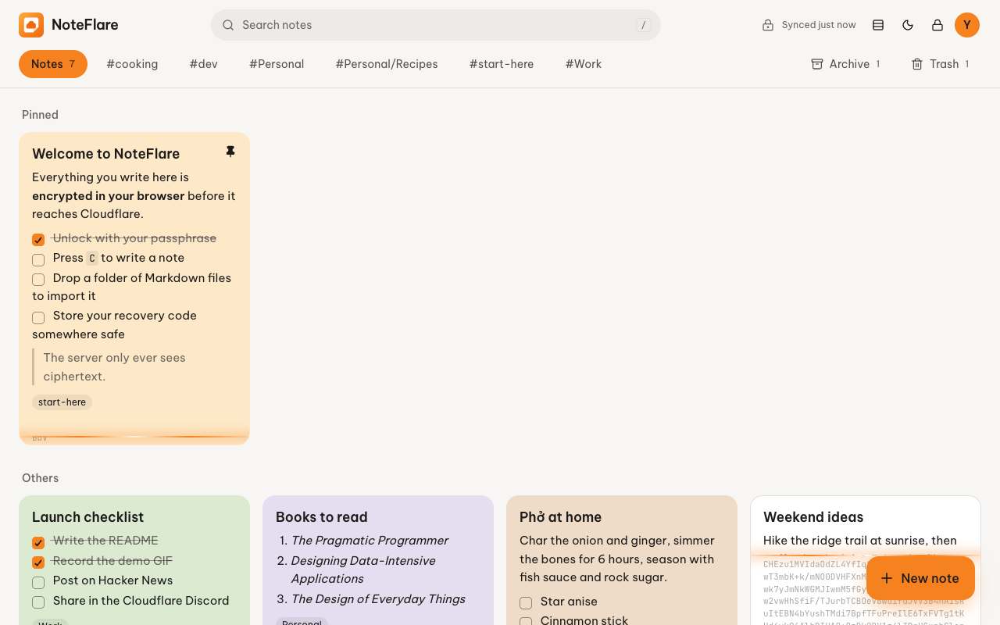
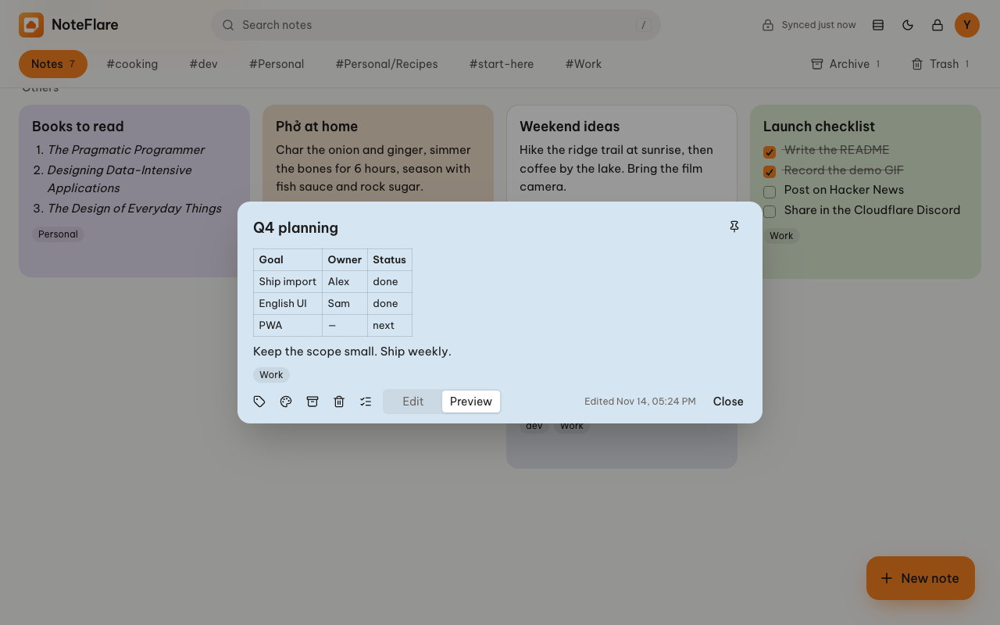
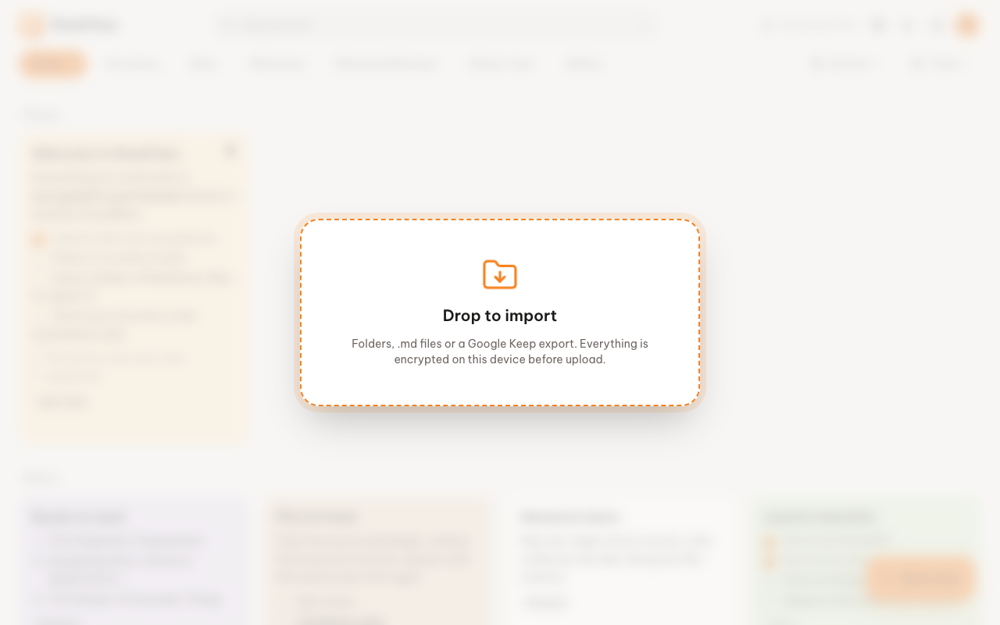
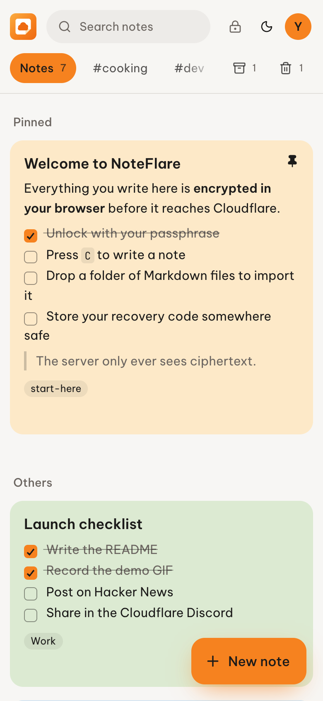

> [!WARNING]
> MẤT **CẢ** PASSPHRASE LẪN MÃ KHÔI PHỤC THÌ GHI CHÚ KHÔNG THỂ KHÔI PHỤC. ĐÓ CHÍNH LÀ Ý NGHĨA CỦA MÃ HOÁ ĐẦU-CUỐI.

<div align="center">



# NoteFlare

**Ghi chú trên Cloudflare, chỉ mình bạn đọc được.**

App ghi chú đơn giản, riêng tư, không cần máy chủ — mã hoá đầu-cuối, chạy miễn phí hoàn toàn, tuỳ biến theo ý bạn.

[English](README.md) · [Tiếng Việt](README.vi.md)

[](https://deploy.workers.cloudflare.com/?url=https://github.com/homielab/noteflare)


[](https://ko-fi.com/homielab)



</div>

## ✨ Tính năng

- 🔐 **Mã hoá đầu-cuối**: Argon2id + AES-256-GCM ngay trong trình duyệt. Máy chủ chỉ lưu ciphertext.
- 💸 **Chạy miễn phí hoàn toàn**: một Worker, một database D1, Cloudflare Access — tất cả trên gói Free.
- 🎨 **Tuỳ biến theo ý bạn**: React, Tailwind, shadcn/ui thuần; một API Hono nhỏ và các file migration SQL thuần.
- 📝 **Ghi chú markdown**: tiêu đề, bảng, trích dẫn, code có tô màu cú pháp, checklist `- [ ]` tick ngay trên thẻ.
- 📌 **Sắp xếp theo cách của bạn**: ghim, kéo ghi chú theo thứ tự bạn muốn, 8 màu giấy, nhãn, lưu trữ, thùng rác tự dọn sau 30 ngày. Chọn nhiều ghi chú, hoặc tất cả, rồi gắn nhãn hoặc chuyển vào thùng rác một lần.
- 📥 **Kéo thả để nhập**: thả một thư mục Markdown (vault Obsidian cũng được), bản xuất Google Keep hoặc bản xuất Evernote, Simplenote, Standard Notes, mọi ghi chú được mã hoá khi nhập.
- 📤 **Xuất và sao lưu**: tải ghi chú về dạng Markdown, hoặc một bản sao lưu đã mã hoá để khôi phục sau này.
- 🖼️ **Ảnh và file mã hoá** (tuỳ chọn): đính kèm ảnh, PDF hay bất kỳ file nào, được mã hoá trước khi tải lên và lưu trong bucket R2 của riêng bạn.
- ✨ **Mở khoá là giải mã tại chỗ**: từng ghi chú hiện ra từ ciphertext ngay khi bạn mở khoá.
- 📱 **Cài như app, dùng được khi offline**: thêm NoteFlare vào màn hình chính. Đọc, viết, mở khoá không cần mạng; có mạng lại thì tự đồng bộ.
- 🔀 **Đồng bộ nhiều thiết bị thông minh**: hai máy cùng sửa một ghi chú thì được gộp theo từng dòng, giống `git merge`. Chỉ khi sửa cùng một dòng khác nhau mới tách thành bản riêng.
- ⚡ **Cập nhật tức thì**: sửa trên một thiết bị, các thiết bị khác đang mở thấy ngay, không cần tải lại.
- 🗝️ **Mã khôi phục**: quên passphrase vẫn không mất ghi chú; đổi passphrase không cần mã hoá lại.
- 👆 **Mở khoá bằng passkey**: Face ID, Touch ID, Windows Hello hoặc khoá bảo mật thay cho gõ passphrase, vẫn mã hoá đầu-cuối.
- 🔗 **Chia sẻ ghi chú bằng liên kết**: gửi một bản chỉ đọc của một ghi chú, mở được mà không cần đăng nhập. Bản này được mã hoá bằng khoá chỉ nằm trong liên kết, nên máy chủ không đọc được. Liên kết có thể hết hạn sau 1, 7 hoặc 30 ngày, và bạn thu hồi được bất cứ lúc nào.
- 🔒 **Tự khoá**: khoá bị xoá khỏi bộ nhớ sau 15 phút không thao tác, hoặc chỉ với một cú nhấp.
- ✍️ **Trình soạn Markdown biết giúp bạn**: danh sách và checklist tự nối dòng khi nhấn Enter, Tab để thụt lề, một chạm để biến các dòng thành checklist.
- 🌗 **Sáng/tối, dạng lưới hoặc danh sách, dùng tốt trên điện thoại**, phím tắt (nhấn `?` để xem), tôn trọng chế độ giảm chuyển động.
- 🔄 **Thông báo cập nhật và ghi chú phát hành ngay trong app**, do chính Worker của bạn kiểm tra, không theo dõi.
- 🌐 **Sáu ngôn ngữ có sẵn** — English, Español, Français, Deutsch, Português (Brasil), Tiếng Việt — lần đầu tự theo ngôn ngữ trình duyệt của bạn; thêm ngôn ngữ chỉ cần một file.
- 🔌 **Tự xây client riêng**: token truy cập, API `/api/v1` ổn định có spec OpenAPI, SDK TypeScript lo phần mã hoá, và CLI.

> [!TIP]
> **NoteFlare dành cho ai?** Cho người muốn sự đơn giản của Google Keep mà không phải giao ghi chú cho ai —
> kể cả máy chủ đang chạy app. Phù hợp với cá nhân và nhóm nhỏ (Cloudflare Access miễn phí tới 50 người).

## 🪧 Ảnh chụp

<table>
  <tr>
    <td width="50%"></td>
    <td width="50%"></td>
  </tr>
  <tr>
    <td></td>
    <td></td>
  </tr>
  <tr>
    <td></td>
    <td></td>
  </tr>
</table>

<p align="center">
  
  &nbsp;
  
</p>

## 📥 Nhập Markdown

Kéo một thư mục (hoặc vài file `.md`) thả vào bất cứ đâu trên NoteFlare, hoặc chọn **Tài khoản → Nhập thư mục Markdown…**.
File được đọc và mã hoá ngay trong trình duyệt rồi tải lên theo lô. Thử với [`examples/sample-notes`](examples/sample-notes).

- **Tiêu đề**: `title` trong frontmatter YAML, nếu không có thì lấy dòng `# Heading` đầu tiên, cuối cùng là tên file
- **Nhãn**: `tags` trong frontmatter (kiểu Obsidian) cộng với thư mục con chứa file
- **Đọc thêm**: `color`, `pinned`, `archived`
- **Bỏ qua**: `.obsidian`, `.git`, `node_modules`, file không phải Markdown và ghi chú đã có (cùng tiêu đề và nội dung) — nhập hai lần vẫn an toàn

**Từ Google Keep**: xuất Keep bằng [Google Takeout](https://takeout.google.com/), giải nén rồi thả thư mục `Keep` vào (hoặc chọn **Tài khoản → Nhập từ Google Keep…**). Tiêu đề, nội dung, checklist, nhãn, màu, ghim và lưu trữ được giữ lại; ghi chú trong thùng rác của Keep và tệp đính kèm (ảnh, âm thanh) thì không.

**Từ Evernote, Simplenote hoặc Standard Notes**: thả file xuất vào NoteFlare, hoặc chọn **Tài khoản → Nhập từ Evernote, Simplenote, Standard Notes…**.
- **Evernote**: File → Export notes, chọn `.enex`. Tiêu đề, nội dung, checklist và thẻ được giữ lại; tệp đính kèm thì không.
- **Simplenote**: Settings → Export notes, giải nén rồi thả `notes.json`. Thẻ và ghim được giữ lại; thùng rác bị bỏ qua.
- **Standard Notes**: Backups → tải bản sao lưu đã giải mã. Ghi chú, thẻ, ghim và lưu trữ được giữ lại; bản sao lưu đã mã hoá thì không đọc được.

## 📤 Xuất và sao lưu

**Tài khoản → Xuất và sao lưu…** có ba việc:

- **Markdown (.zip)**: mỗi ghi chú là một file `.md` đọc được, có frontmatter, kèm ảnh và file đính kèm. Nhập lại vào NoteFlare được, hoặc mở bằng bất kỳ trình soạn Markdown nào. File này **không được mã hoá**, hãy cất ở nơi an toàn.
- **Bản sao lưu đã mã hoá**: một file `.json` chứa ghi chú đúng như máy chủ lưu, vẫn ở dạng mã hoá. Không có passphrase thì vô dụng. Không bao gồm thùng rác, ảnh và file đính kèm.
- **Khôi phục**: chọn một bản sao lưu đã mã hoá, ghi chú trong đó được thêm vào sổ; ghi chú bạn đã có sẽ được bỏ qua. Bản sao lưu từ một bản triển khai khác, hoặc từ trước khi đặt lại bằng mã khôi phục, sẽ hỏi passphrase đang dùng vào lúc tạo nó.

Khi đã bật binding R2 (xem mục Ảnh và file), NoteFlare còn tự lưu một bản sao lưu đã mã hoá mỗi ngày và giữ 14 bản gần nhất. Chúng nằm ở mục **Sao lưu hằng ngày** trong cùng hộp thoại; khôi phục từ đó.

## 🖼️ Ảnh và file

Ghi chú có thể kèm ảnh và bất kỳ file nào khác (PDF, bảng tính, file zip), được mã hoá như mọi thứ khác. Tính năng này mặc định tắt vì cần một bucket R2, và R2 yêu cầu phương thức thanh toán dù có 10 GB miễn phí.

Để bật, bỏ dấu chú thích ở dòng `r2_buckets` trong `wrangler.jsonc` rồi deploy; bucket được tạo tự động. Khi đó nút **Đính kèm file** hiện trong trình soạn, và bạn cũng có thể thả file hoặc dán ảnh vào ghi chú. Ảnh hiện ngay trong ghi chú; file khác hiện thành một thẻ có tên và dung lượng, bấm vào là tải về.

- Mọi thứ được mã hoá trong trình duyệt bằng khoá dữ liệu của bạn trước khi tải lên. Máy chủ chỉ lưu khối dữ liệu không đọc được, không biết nội dung, tên file hay loại file.
- Mọi loại file, mỗi file tối đa 10 MB. Ảnh PNG, JPEG, GIF, WebP và AVIF được hiển thị ngay trong ghi chú.
- Xoá vĩnh viễn một ghi chú cũng xoá những file đính kèm chỉ ghi chú đó dùng. Ghi chú bị dọn khỏi thùng rác sau 30 ngày thì file đính kèm vẫn nằm lại trong bucket.
- Lần đầu mỗi thiết bị hiển thị một ảnh cần có mạng, và mỗi lần tải một file về cũng vậy.

## 🔗 Chia sẻ ghi chú bằng liên kết

Mở menu của ghi chú và chọn **Chia sẻ liên kết**. Chọn thời hạn (1 ngày, 7 ngày, 30 ngày hoặc không hết hạn), rồi **Tạo liên kết**: liên kết được sao chép sẵn cho bạn. Ai có liên kết đều đọc được ghi chú trên mọi trình duyệt, không cần đăng nhập.

- Liên kết chứa bản sao tiêu đề và nội dung của ghi chú ở thời điểm tạo. Các chỉnh sửa sau đó, nhãn, màu và ảnh không được chia sẻ.
- Ghi chú được mã hoá ngay trong trình duyệt của bạn bằng một khoá mới cho mỗi liên kết. Khoá là phần sau dấu `#`, phần mà trình duyệt không bao giờ gửi lên máy chủ, nên máy chủ của bạn chỉ lưu ciphertext. Ai có trọn liên kết đều đọc được ghi chú, nên chỉ gửi cho người bạn tin.
- **Chia sẻ liên kết** cũng liệt kê các liên kết đang hoạt động của ghi chú; thu hồi ngay tại đó. Chuyển ghi chú vào thùng rác sẽ thu hồi mọi liên kết của nó, và liên kết hết hạn bị xoá mỗi đêm.
- Chỉ trang chia sẻ (`/s/…`) và dữ liệu của nó (`/api/share/…`) là công khai; phần còn lại của NoteFlare vẫn nằm sau Cloudflare Access. Phần cài đặt trong app tự mở chúng; nếu bạn tự cài Access, xem bước 8 bên dưới.

## 📱 Cài lên điện thoại, dùng khi offline

NoteFlare là Progressive Web App. Mở địa chỉ NoteFlare của bạn, đăng nhập một lần, rồi:

- **Android (Chrome)**: *menu Tài khoản → Cài ứng dụng*, hoặc menu Chrome → *Cài đặt ứng dụng*
- **iPhone / iPad (Safari)**: *Chia sẻ → Thêm vào Màn hình chính* (*menu Tài khoản → Cài ứng dụng* sẽ hiện các bước)
- **Máy tính (Chrome, Edge)**: biểu tượng cài đặt trên thanh địa chỉ, hoặc *menu Tài khoản → Cài ứng dụng*

**Dùng được khi offline**: mở app, mở khoá bằng passphrase, đọc, tìm kiếm, viết, sửa, ghim, lưu trữ, xoá và nhập Markdown. Header hiện *Offline · N chưa đồng bộ* cho tới khi mọi thay đổi lên tới Worker. Tạo tài khoản mới và khôi phục bằng mã cần có mạng.

**Sau khi cài**:

- **Chia sẻ vào NoteFlare** từ app khác (Android): chữ và link được chia sẻ thành ghi chú mới, lưu ngay khi bạn mở khoá.
- **Mở file `.md` bằng NoteFlare** (Chrome, Edge trên máy tính): file được mã hoá và nhập như khi kéo thả thư mục.
- **Ghi chú mới** từ menu phím tắt của biểu tượng app.
- Mở lại app sẽ chuyển tới cửa sổ đang mở, không phải mở khoá lại lần nữa.
- Khi có phiên bản mới, NoteFlare hỏi bạn tải lại thay vì tự đổi giữa chừng.

**Cách hoạt động**: service worker lưu sẵn bản thân ứng dụng. Ghi chú được app lưu trong IndexedDB — đúng loại ciphertext mà máy chủ giữ, cùng khoá đã bọc — nên bản trên máy cũng không đọc được nếu thiếu passphrase. Thay đổi được xếp hàng trên máy và gửi lên theo thứ tự khi có mạng.

### Khi hai thiết bị cùng sửa một ghi chú

Mỗi ghi chú có số phiên bản. Khi một máy gửi bản sửa dựa trên phiên bản cũ, máy chủ từ chối, và máy đó gộp hai bản sửa dựa trên phiên bản gốc mà cả hai cùng bắt đầu:

| Máy A | Máy B | Kết quả |
|---|---|---|
| Tick mục đầu tiên | Thêm một mục ở cuối | Một ghi chú có cả hai thay đổi |
| Sửa dòng 2 | Xoá dòng 5 | Cả hai thay đổi đều được áp dụng |
| Thêm nhãn `work` | Thêm nhãn `q4`, bỏ `old` | `work`, `q4` — `old` bị bỏ |
| Đổi tên thành "A" | Đổi tên thành "B" | Giữ bản trên máy chủ, bản của bạn lưu thành **"… (conflict copy)"** |
| Sửa dòng 3 thành "sữa yến mạch" | Sửa dòng 3 thành "sữa đậu nành" | Như trên: không mất gì, bạn chọn bản muốn giữ |

Việc gộp chạy trong trình duyệt trên nội dung đã giải mã; máy chủ không bao giờ thấy nội dung. Màu, ghim, lưu trữ không bao giờ tạo bản sao: máy đồng bộ sau thắng.

### Mẹo dùng Cloudflare Access trên điện thoại

- App thêm vào màn hình chính trên iPhone có cookie riêng, tách khỏi Safari, nên bạn đăng nhập một lần ngay trong app.
- Phiên Access mặc định kéo dài 24 giờ. Với app ghi chú mở hằng ngày, hãy tăng **Session Duration** của Access application (ví dụ 1 tuần hoặc 1 tháng). Khi phiên hết hạn, NoteFlare vẫn chạy trên bản trên máy và hiện *Đăng nhập để đồng bộ*.
- Nếu trình duyệt không đề nghị cài app, hoặc biểu tượng trên màn hình chính bị trống, có thể trình duyệt đang tải icon mà không kèm cookie Access. Thêm một Access application thứ hai cho đường dẫn `/manifest.webmanifest` và `/icons/` với policy **Bypass** (chúng chỉ chứa tên app và icon).

## 🔌 Tích hợp và API

Kết nối script, plugin cho editor, extension trình duyệt hay ứng dụng của riêng bạn. Tạo token ở **Tài khoản → Tích hợp** (chỉ đọc hoặc đọc và ghi, có hạn dùng), rồi:

```ts
import { NoteFlareClient } from '@noteflare/client'

const nf = new NoteFlareClient({ url: 'https://notes.example.com', token: 'nf_…' })
await nf.unlock(passphrase)                       // giải mã vẫn diễn ra ở phía bạn
await nf.create({ title: 'Từ script của tôi', body: '- [ ] chạy rồi' })
```

```bash
echo "- [ ] Mang áo khoác" | noteflare append "trip"      # CLI trong packages/cli
noteflare export ./backup                                 # Markdown nhập lại được
```

`noteflare mcp` cho phép Claude, Cursor và các công cụ AI khác đọc và ghi ghi chú của bạn, giải mã ngay trên máy bạn: xem [MCP server](docs/API.md#mcp-server-ai-tools).

Token chỉ lấy được bản đã mã hoá: client vẫn cần passphrase của bạn mới đọc được. Mỗi địa chỉ IP gửi được 60 request kèm token mỗi phút; quá mức đó API trả `429` (đổi ở mục `ratelimits` trong `wrangler.jsonc`). **[Hướng dẫn API](docs/API.md)** (tiếng Anh) mô tả các endpoint, đồng bộ, xử lý xung đột, cấu hình Cloudflare Access cho `/api/v1` và định dạng mã hoá chính xác kèm ví dụ Python — để viết client bằng bất kỳ ngôn ngữ nào. Spec OpenAPI có tại `/api/v1/openapi.json`.

## 🔐 Mã hoá hoạt động thế nào

```
passphrase    ──Argon2id (64 MiB, t=3)──► KEK  ──AES-GCM wrap──► wrappedDek   ┐
mã khôi phục  ──HKDF-SHA256─────────────► RKEK ──AES-GCM wrap──► recoveryDek  ├─ lưu trong D1
PRF passkey   ──HKDF-SHA256─────────────► PKEK ──AES-GCM wrap──► bản của passkey │  (mỗi passkey một bản)
DEK ngẫu nhiên 256-bit ──AES-GCM, AAD = "note:<id>"──► ciphertext của note    ┘
```

- Passphrase, khoá dữ liệu (DEK) và nội dung note không bao giờ rời trình duyệt ở dạng rõ. Chỉ `pinned`, `archived`, `trashed_at`, `position` và thời gian sửa là dạng rõ để sắp xếp.
- **Passkey** (Tài khoản → Mở khoá bằng passkey…): phần mở rộng PRF của WebAuthn cho trình duyệt một bí mật chỉ passkey đó tạo ra được, sau khi qua Face ID, Touch ID hoặc PIN. Bí mật này bọc thêm một bản DEK. Máy chủ lưu bản đó và salt PRF, không bao giờ thấy bí mật. Xoá passkey là xoá bản của nó; passphrase và mã khôi phục vẫn dùng được, đổi passphrase không ảnh hưởng passkey. Cần trình duyệt và trình quản lý passkey hỗ trợ PRF (Chrome, Edge, Safari đời mới với iCloud Keychain, Trình quản lý mật khẩu của Google hoặc Windows Hello); nơi khác thì tuỳ chọn này bị ẩn.
- Trong phiên làm việc, DEK là `CryptoKey` **non-extractable**, chỉ nằm trong RAM. Khoá là xoá nó đi.
- Bản offline trên máy chỉ chứa ciphertext và khoá đã bọc giống máy chủ. Đăng xuất sẽ xoá nó.
- Ciphertext mỗi note gắn với id của nó, máy chủ không tráo nội dung giữa các note được.
- Client từ chối tham số Argon2 yếu hơn ngưỡng an toàn, chống máy chủ hạ cấp KDF.
- Worker tự kiểm tra JWT của Cloudflare Access (chữ ký, issuer, audience), không tin header suông.

## 🧱 Công nghệ

Cloudflare Workers (Static Assets, Cron Trigger) · D1 · Cloudflare Access + jose · Hono · React 19 · Tailwind CSS 4 · shadcn/ui · View Transitions API · TanStack Markdown · WebCrypto + hash-wasm · Service Worker + IndexedDB (idb)

## 🏗️ Triển khai

### Một cú nhấp (không cần biết lập trình)

Xem trước từng bước: [video 3 phút có thuyết minh](https://noteflare.homielab.com/vi/start/deploy/).

Bạn cần một tài khoản [Cloudflare](https://dash.cloudflare.com/sign-up) miễn phí và một tài khoản [GitHub](https://github.com/signup) miễn phí. Mất khoảng 10 phút, phần lớn là chờ lần deploy đầu tiên.

**Phần 1: Triển khai app**

1. Nhấn nút **Deploy to Cloudflare** ở đầu trang này và đăng nhập Cloudflare.
2. Ở mục **Git account**, kết nối tài khoản GitHub của bạn (**New GitHub connection**, rồi **Authorize** và **Install & Authorize** trên GitHub) và chọn nó. Tick **Create private Git repository**.

   Nếu sau khi kết nối GitHub, Cloudflare hiện *Select a repository*, hãy nhấn lại nút Deploy to Cloudflare: tài khoản của bạn giờ đã có trong danh sách.
3. Điền form. Chỉ một ô cần nhập:

   | Ô | Cần làm gì |
   | --- | --- |
   | `ALLOWED_EMAILS` | Nhập email của chính bạn. |
   | Các ô còn lại | Giữ nguyên (`ACCESS_TEAM_DOMAIN` và `ACCESS_AUD` để `todo`). |

4. Nhấn **Deploy** và chờ build xong (khoảng một phút).
5. Mở **Overview** và nhấn **Visit** (link dạng `noteflare.<subdomain>.workers.dev`; nếu trang ghi *No URLs enabled*, hãy tải lại trang). NoteFlare hiện **Hoàn tất cài đặt NoteFlare**.

**Phần 2: Cài đặt đăng nhập**

NoteFlare tự đặt trang đăng nhập Cloudflare Access trước nó, để chỉ email của bạn mở được. Access miễn phí tới 50 người.

1. Nhấn **Tạo token trên Cloudflare**. Các quyền NoteFlare cần đã được chọn sẵn: nhấn **Continue to summary**, rồi **Create Token**, và sao chép token.
2. Quay lại NoteFlare, dán token, kiểm tra email, rồi nhấn **Cài đặt đăng nhập**.
3. Nhấn **Đăng nhập** và nhập mã Cloudflare gửi qua email.
4. Xoá token trên Cloudflare (**My Profile → API Tokens**). NoteFlare chỉ dùng nó một lần và không giữ lại.

Token chỉ dùng được với tài khoản Cloudflare đang chạy NoteFlare, nên không ai khác cài đặt thay bạn được. Muốn tự bấm qua Zero Trust? Xem [Tự cài Cloudflare Access](#tự-cài-cloudflare-access).

**Phần 3: Tạo passphrase**

1. Chọn một passphrase. Đây là thứ mã hoá ghi chú của bạn.
2. Ghi lại **mã khôi phục** và cất ở nơi an toàn, tách khỏi passphrase.

### Nhờ AI agent

Để một coding agent có quyền dùng terminal (Claude Code, Codex, Gemini CLI…) deploy giúp bạn. Trước tiên tạo một deploy token: Cloudflare dashboard → **My Profile → API Tokens → Create Token → Create Custom Token**, với các quyền:

| Quyền | Để làm gì |
| --- | --- |
| Account → **Workers Scripts** → Edit | Tải Worker, các file và lịch dọn thùng rác hằng ngày lên, bật link `workers.dev` |
| Account → **D1** → Edit | Tạo database `noteflare` và chạy migration |
| Account → **Workers R2 Storage** → Edit | Chỉ khi bạn bật đính kèm ảnh trong `wrangler.jsonc` |

Giới hạn **Account Resources** vào tài khoản của bạn. Account ID nằm ở trang chủ dashboard (**Account ID**, trong menu tài khoản). Rồi clone repo này, mở agent trong thư mục của nó và dán:

```text
Deploy NoteFlare from this folder to my Cloudflare account.

1. Read README.md, docs/ARCHITECTURE.md and wrangler.jsonc first.
2. I need Bun (https://bun.sh) and Node 20+. Check `bun --version` and `node --version`; tell me if one is missing.
3. Ask me to create a file named `.env` in this folder myself, with these two lines:
   CLOUDFLARE_ACCOUNT_ID=<my account ID>
   CLOUDFLARE_API_TOKEN=<my deploy token>
   Never ask me to paste the token in the chat, never print, log or commit it, and never pass it as a command argument. `.env` is in .gitignore and Wrangler reads it on its own; check that `git status` does not list it.
4. Keep the Worker name `noteflare` and the database name `noteflare`. Do not change any other value in wrangler.jsonc.
5. Run `bun install`, then `bun run deploy` (build, deploy the Worker and create the D1 database, apply migrations). If it fails, show me the error and how to fix it.
6. Give me the `https://noteflare.<subdomain>.workers.dev` link from the deploy output. Tell me to open it and finish on the "Finish setting up NoteFlare" screen (README, Deploy, Part 2 and Part 3), then delete `.env` and the deploy token.
7. Talk to me in Vietnamese.
```

### Dòng lệnh

```bash
bun install
bunx wrangler login
bun run deploy   # build → deploy Worker (tự tạo D1) → chạy migration
```

Sau đó mở link và làm theo Phần 2 ở trên.

### Tự cài Cloudflare Access

Thay cho cách cài trong app ở Phần 2:

1. Trong [Cloudflare dashboard](https://dash.cloudflare.com), mở **Zero Trust**. Lần đầu, nó yêu cầu bạn đặt tên team và chọn gói Free. Nhớ tên team này.
2. Vào **Access controls → Applications → Create new application → Self-hosted and private**.
   - Name: `NoteFlare`
   - Chọn **Add public hostname** và nhập địa chỉ NoteFlare của bạn, ví dụ `notes.example.com` hoặc `noteflare.<subdomain>.workers.dev`

   Với link `workers.dev`, bạn cũng có thể bật Access trong **Workers & Pages → noteflare → Settings → Domains & Routes**.
3. Thêm policy: *Allow* → *Emails* → email của bạn. Lưu application. Đăng nhập bằng mã OTP qua email dùng được ngay; đăng nhập Google/GitHub cũng được.
4. Chép **Application Audience (AUD) Tag**: trong **Access controls → Applications**, chọn **Edit** ở NoteFlare, mở **Additional settings** và chép giá trị đó (một chuỗi dài gồm chữ và số).
5. Điền cả hai giá trị vào `wrangler.jsonc` thay cho `todo`. Nếu bạn dùng nút một cú nhấp, mở repository `noteflare` mới trên GitHub, mở `wrangler.jsonc`, nhấn biểu tượng bút chì và sửa các dòng sau:

   ```jsonc
   "vars": {
     "ACCESS_TEAM_DOMAIN": "https://<team-cua-ban>.cloudflareaccess.com",
     "ACCESS_AUD": "<AUD tag>",
     "ALLOWED_EMAILS": "ban@example.com"   // tuỳ chọn: lớp khoá thứ hai, do Worker kiểm tra
   }
   ```

6. Deploy lại. Trên GitHub, nhấn **Commit changes** và Cloudflare tự deploy lại sau vài phút. Với dòng lệnh, chạy `bun run deploy`.
7. Mở link NoteFlare. Bạn sẽ thấy trang đăng nhập của Cloudflare, rồi tới NoteFlare.
8. Tuỳ chọn, cho [liên kết chia sẻ](#-chia-sẻ-ghi-chú-bằng-liên-kết): tạo thêm một self-hosted application tên `NoteFlare shared links` với hai public hostname, là địa chỉ NoteFlare của bạn với path `s` và với path `api/share`, cùng một policy có action **Bypass** và include **Everyone**. Thiếu bước này, người nhận liên kết sẽ thấy trang đăng nhập của Cloudflare.

Sau đó làm theo [checklist bảo mật](SECURITY.md#hardening-checklist-for-your-deployment).

## 🔄 Cập nhật

NoteFlare báo cho bạn khi có phiên bản mới: một chấm nhỏ hiện trên avatar, và mục **Giới thiệu và cập nhật** trong menu tài khoản hiển thị ghi chú phát hành. Sau khi cập nhật, tab **Có gì mới** liệt kê những thay đổi.

Việc kiểm tra chạy trên Worker của bạn, không phải trong trình duyệt. Worker hỏi GitHub bản phát hành mới nhất của `homielab/noteflare` tối đa 6 tiếng một lần và không gửi bất cứ thông tin gì về bạn hay ghi chú. Đặt `UPDATE_CHECK_REPO` trong `wrangler.jsonc` thành `owner/repo` của bản fork để theo dõi bản phát hành của riêng bạn, hoặc `"off"` để tắt.

**Triển khai bằng nút Deploy?** Cloudflare đã tạo một bản sao repo trong tài khoản GitHub của bạn và tự deploy mỗi lần push. Cập nhật chỉ cần một cú nhấp, sau một lần cài đặt.

*Một lần: thêm nút cập nhật.* Nút Deploy không chép file này vào bản sao của bạn, nên bạn tự thêm:

1. Mở [`update.yml`](https://github.com/homielab/noteflare/blob/main/.github/workflows/update.yml) và chép nội dung (biểu tượng copy ở góc trên bên phải của file).
2. Trong repository `noteflare` **của bạn** trên GitHub, chọn **Add file → Create new file**.
3. Đặt tên `.github/workflows/update.yml`, dán vào rồi nhấn **Commit changes**.

*Mỗi lần: cập nhật.*

1. Trong repository của bạn, mở tab **Actions** và chọn **Update NoteFlare**.
2. Nhấn **Run workflow**, rồi **Run workflow** lần nữa.
3. Cloudflare deploy phiên bản mới sau vài phút.

*Tuỳ chọn: cập nhật ngay trong app.* Thêm hai cài đặt nữa, mục **Giới thiệu và cập nhật** sẽ có nút **Cập nhật ngay**, chạy giúp bạn đúng workflow trên:

1. Trên GitHub, mở **Settings → Developer settings → Personal access tokens → Fine-grained tokens → Generate new token**. Đặt tên và hạn dùng, chọn **Only select repositories** rồi chọn repository `noteflare` của bạn, sau đó ở **Repository permissions** đặt **Actions** thành **Read and write**. Tạo token và chép lại.
2. Trong Cloudflare dashboard, mở **Workers & Pages → noteflare → Settings → Variables and Secrets** và thêm hai giá trị kiểu **Secret**: `GITHUB_UPDATE_TOKEN` là token vừa tạo, và `GITHUB_UPDATE_REPO` là repository của bạn dạng `owner/noteflare`.
3. Tải lại NoteFlare. Khi có phiên bản mới, nhấn **Cập nhật ngay**; Cloudflare deploy sau vài phút và NoteFlare sẽ đề nghị tải lại.

Token nằm trong Worker của bạn và không bao giờ được gửi tới trình duyệt. Chỉ bạn, khi đã đăng nhập qua Cloudflare Access, mới bắt đầu cập nhật được; API token thì không. Token chỉ chạy được workflow trong đúng repository đó; xoá token trên GitHub để tắt nút này.

Bản cập nhật giữ nguyên cài đặt trong `wrangler.jsonc` của bạn (database id, giá trị Cloudflare Access). Nếu bạn đã tự sửa code, thay đổi của bạn được giữ ở những chỗ không trùng với phiên bản mới; chỗ nào trùng thì phiên bản mới thắng.

Thích dùng terminal? Trong bản clone của bản sao:

```bash
curl -fsSL https://raw.githubusercontent.com/homielab/noteflare/main/scripts/update-from-upstream.sh | bash
git push                                                         # Workers Builds sẽ deploy
```

**Triển khai bằng dòng lệnh?**

```bash
git pull
bun install
bun run deploy   # đồng thời chạy migration mới cho database
```

Ghi chú, khoá và cài đặt nằm trong D1 và không bị đụng tới; migration chỉ thêm vào schema. Hãy đọc [changelog](CHANGELOG.md) để xem mục **Breaking** trước khi lên phiên bản minor mới.

## 🧑‍💻 Chạy local

```bash
cp dev.vars.sample .dev.vars     # DEV_USER_EMAIL=you@example.com — chỉ dùng local
bun run db:migrate:local
bun run dev:api                  # terminal 1: Worker + D1 local ở :8787
bun run dev                      # terminal 2: Vite ở :5173, proxy /api
bun run test
```

Service worker chỉ có trong bản build production. Muốn thử chế độ offline ở máy, chạy `bun run build && bun run dev:api` rồi mở http://localhost:8787.

## 💸 Hạn mức miễn phí

| Dịch vụ | Free | NoteFlare dùng thế nào |
|---|---|---|
| Workers | 100.000 request/ngày | Mỗi lần lưu là 1 request, có debounce khoảng 0,7 giây |
| D1 | 5 triệu row đọc, 100.000 row ghi/ngày; 500 MB/database | Mỗi lần làm mới chỉ tải note đã thay đổi |
| Access | 50 người dùng | Mỗi người bạn cho vào chiếm một chỗ |
| Durable Objects | 100.000 request/ngày (mỗi 20 tin nhắn WebSocket gửi tới tính 1) | Mỗi người một object giữ các kết nối của thiết bị đang mở; không lưu dữ liệu |
| R2 (tuỳ chọn) | 10 GB lưu trữ | Chỉ khi bạn bật [ảnh](#️-ảnh); mỗi ảnh là một object |

## 🎨 Tuỳ biến

| Muốn… | Sửa ở |
|---|---|
| Đổi màu, font, bảng màu note, chuyển động | `src/index.css` — token ở đầu, motion ở cuối file |
| Sửa chữ trên giao diện hoặc thêm ngôn ngữ | `src/i18n/en.ts` (danh sách khoá), thêm ví dụ `fr.ts` rồi đăng ký trong `src/i18n/index.tsx` |
| Chỉnh độ nặng mã hoá | `DEFAULT_KDF` trong `packages/client/src/crypto.ts` |
| Đổi thời gian tự khoá, tự lưu | `IDLE_LOCK_MS` trong `src/lib/vault.tsx`, `DEBOUNCE_MS` trong `src/lib/sync/engine.ts` |
| Tô màu thêm ngôn ngữ trong khối code | `src/lib/highlight.ts` |
| Đổi cách gộp thay đổi giữa hai thiết bị | `packages/client/src/merge.ts` (test ở `tests/merge.test.ts`) |
| Đổi icon hoặc tên khi cài | `public/icons/`, `public/manifest.webmanifest` |
| Đổi thời gian giữ thùng rác | `TRASH_TTL_MS` trong `worker/index.ts`, `triggers.crons` trong `wrangler.jsonc` |
| Theo dõi bản phát hành của fork, hoặc tắt kiểm tra cập nhật | `UPDATE_CHECK_REPO` trong `wrangler.jsonc` |

## 🚗 Lộ trình

- [x] Mã hoá đầu-cuối kèm mã khôi phục
- [x] Markdown với checklist tick được
- [x] Nhãn, ghim, lưu trữ, thùng rác tự dọn
- [x] Mở khoá giải mã tại chỗ và View Transitions
- [x] Giao diện tiếng Anh, Tây Ban Nha, Pháp, Đức, Bồ Đào Nha (Brasil) và tiếng Việt
- [x] Kéo thả để nhập Markdown
- [x] Cài như app, dùng được khi offline
- [x] Tự động gộp 3 chiều giữa các thiết bị
- [x] API công khai, token truy cập, SDK TypeScript và CLI
- [x] Xuất ra Markdown (CLI)
- [x] Xuất từ web app, sao lưu đã mã hoá và khôi phục
- [x] Kéo thả sắp xếp
- [x] Đính kèm ảnh mã hoá trên R2
- [x] Nhập từ Google Keep Takeout

## 🙋 Hỏi đáp

**Cloudflare có đọc được ghi chú không?** Không. Ghi chú được mã hoá trong trình duyệt trước khi gửi đi; D1 chỉ chứa ciphertext và khoá đã bọc.

**Sao dùng Cloudflare Access thay vì đăng nhập bằng mật khẩu?** Access lo đăng nhập, MFA và phiên làm việc ngay tại edge, miễn phí, nên app không phải tự viết phần xác thực. Passphrase là bí mật riêng, chỉ dùng để mã hoá.

**Có thật sự miễn phí?** Có, trên gói Free của Cloudflare và trong hạn mức ở trên. Không có dịch vụ trả phí nào trong hệ thống.

**Có app điện thoại không?** NoteFlare cài từ trình duyệt như một app (xem [Cài lên điện thoại](#-cài-lên-điện-thoại-dùng-khi-offline)) và dùng được khi offline. Không có bản trên App Store.

**Sửa cùng một ghi chú trên điện thoại và laptop thì sao?** Thay đổi ở các dòng khác nhau được gộp tự động. Nếu hai máy sửa cùng một dòng khác nhau, bạn có cả hai bản: bản của máy kia trong ghi chú, bản của bạn trong "conflict copy" ngay bên cạnh.

**Mang vault Obsidian sang được không?** Được — thả cả thư mục vault. Tags trong frontmatter và thư mục con thành nhãn, `.obsidian/` được bỏ qua. Wiki-link và embed giữ nguyên dạng chữ.

## 📚 Tài liệu

| Tài liệu | Dành cho |
| --- | --- |
| [Hướng dẫn API](docs/API.md) | Viết script và ứng dụng dùng `/api/v1`, SDK và CLI |
| [Kiến trúc](docs/ARCHITECTURE.md) | Worker, D1, mã hoá và đồng bộ offline phối hợp ra sao |
| [Bảo mật](SECURITY.md) | Mô hình đe doạ, server thấy được gì, cách báo lỗ hổng |
| [Đóng góp](CONTRIBUTING.md) | Cài đặt môi trường, chạy test, checklist khi gửi pull request |
| [Nhật ký thay đổi](CHANGELOG.md) | Thay đổi qua từng phiên bản |

Tài liệu chi tiết hiện chỉ có bằng tiếng Anh.

## 📄 Giấy phép

[MIT](LICENSE). NoteFlare là dự án độc lập, không liên kết với Cloudflare hay Google. Bảng màu cam là lời chào tới nền tảng mà nó chạy trên đó; logo là thiết kế riêng, không dùng nhãn hiệu của Cloudflare.

## ⭐ Ủng hộ

NoteFlare miễn phí, không quảng cáo, không theo dõi, và sẽ luôn như vậy. Nếu nó giữ ghi chú của bạn an toàn:

- **Gắn sao cho repo** để người khác tìm thấy dự án.
- **[Mời mình một ly cà phê trên Ko-fi](https://ko-fi.com/homielab)** để có thêm thời gian phát triển.
- **Cho mình biết bạn đã triển khai** trong [Discussions](https://github.com/homielab/noteflare/discussions). Không có telemetry nên đó là cách duy nhất để biết nó chạy tốt.

[](https://ko-fi.com/homielab)
